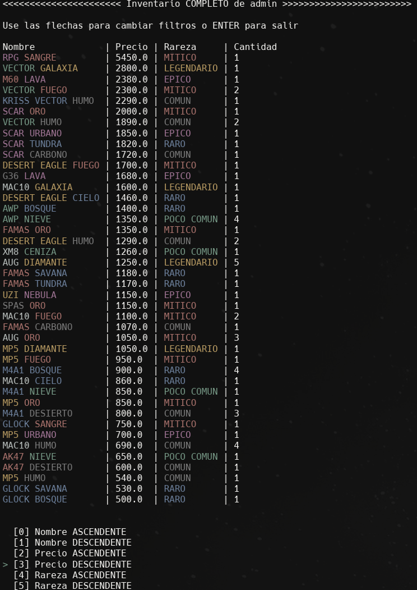

# DataSkins

Aplicación interactiva de consola (CLI) desarrollada en **Python 3** que simula una plataforma de apertura de cajas virtuales, gestión de inventario y mercado de armas y camuflajes entre usuarios.

> **Proyecto grupal:** Trabajo realizado en equipo para la carrera de **Técnico Superior en Análisis de Sistemas** (ISFT N° 179 Dr. Carlos Pellegrini).
> - **Repositorio original:** Fork de [`ReFraX32/DataSkins`](https://github.com/ReFraX32/DataSkins).
> - **Mi rol y aporte:** Participé como **Desarrollador** en el equipo del proyecto. En el repositorio original todo el código grupal se subió unificado en el commit inicial (`b43678a`), y en este fork (`0ce8c67`) incorporé la captura local del sistema y la documentación del repositorio.

## Captura



## Qué hace el sistema

- **Gestión de usuarios (`gestion_usuarios.py`):** Registro, inicio y cierre de sesión persistente, recuperación de contraseña validando correo electrónico y carga ficticia de saldo.
- **Apertura de cajas (`apertura_cajas.py`):** Selección de cajas con precios específicos o caja aleatoria, cálculo de recompensas según probabilidades acumuladas de armas y camuflajes, y animación ASCII en consola.
- **Inventario con filtros en tiempo real (`gestion_inventarios.py`):** Visualización del inventario completo, solo armas o solo camuflajes, con ordenamiento ascendente y descendente por nombre, precio, rareza (`COMUN` a `LEGENDARIO`) y cantidad.
- **Mercado entre usuarios (`gestion_mercado.py`):** Publicación de ítems propios a la venta, compra de armas publicadas por otros usuarios y retiro de publicaciones.
- **Enciclopedia (`enciclopedia.py`):** Catálogo de todas las armas y camuflajes disponibles con sus precios y porcentajes de probabilidad.
- **Modo Administrador (`modo_admin.py`):** Edición de cajas, contenido de cajas, camuflajes, armas y usuarios.

## Tecnologías utilizadas

- **Python 3** (únicamente librería estándar, sin dependencias externas):
  - `msvcrt` (en Windows) y `termios` / `tty` (en Linux/macOS) para navegación de menús en tiempo real con las flechas del teclado y `Enter`.
  - `re` (expresiones regulares) para limpiar secuencias de color ANSI al calcular el ancho de columnas y alinear tablas en consola (`reservacion_de_espacio` en `utilidades.py`).
  - `runpy` para la navegación modular entre los distintos scripts del sistema.
  - `random` y `time` para el sistema de probabilidades y animaciones de apertura.
  - Persistencia local en archivos `.dat` dentro de `diccionarios/` mediante serialización de diccionarios de Python.

## Estructura del proyecto

```text
DataSkins/
├── diccionarios/             # Archivos .dat de persistencia (usuarios, mercado, cajas, etc.)
├── img/
│   └── dataskin.png          # Captura de la interfaz en terminal
├── menu_principal.py         # Punto de entrada principal del sistema
├── gestion_usuarios.py       # Registro, login, sesión y saldo
├── gestion_inventarios.py    # Inventario del usuario y filtros de ordenamiento
├── apertura_cajas.py         # Lógica de probabilidades y apertura de cajas
├── gestion_mercado.py        # Compra y venta de ítems entre usuarios
├── enciclopedia.py           # Consulta de catálogo de armas y camuflajes
├── modo_admin.py             # Panel de edición administrativa
├── utilidades.py             # Motor de menús interactivos, lectura de teclado y archivos
├── Documentación.pdf         # Informe técnico del grupo y diagrama DER
└── LICENSE                   # Licencia GPL-3.0
```

## Cómo ejecutarlo

Es importante ejecutar el programa posicionado dentro de la carpeta `DataSkins` (ya que utiliza rutas relativas hacia `diccionarios/`):

```bash
git clone https://github.com/Uri46/DataSkins.git
cd DataSkins
python menu_principal.py
```

Utilizá las flechas `↑` / `↓` del teclado para desplazarte por los menús y `Enter` para confirmar cada opción.
